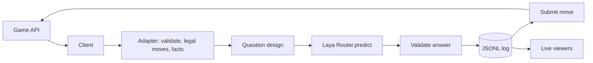

# laya-game-agent

A decision layer that plays hosted games through their agent APIs, where **every move is chosen by a visible, logged call to [Laya](https://github.com/NandhaKishorM/laya)**, a small open-weight decision model. Built for PS 02, "Beat the Bot: Teach Laya to Play".

The bot reads the game state, turns it into a short factual description plus typed questions, asks Laya, checks that the answer maps to a legal move, writes the whole decision to a JSONL log, and only then sends the move.

> Status: the reusable foundation is done and tested against real Laya. The hosted game adapters are written on hackathon day, when the game APIs are revealed. Nothing in this repo guesses an endpoint, a field name or a score.

## Why Laya, and why the question design matters

Laya answers `choice`, `score` and yes/no (`noul`) questions in one forward pass, locally, in about 30 to 40 ms on a T4 GPU (maintainer figure) or about 400 ms on our laptop CPU (measured). It does not generate text, so every decision comes with a full probability distribution we can log and audit.

It is not a game engine. Out of the box it is weak at decisions: in our first test it gave the *correct* move the *lowest* probability, and reversing the option order flipped its answer. How we phrase the state, the options and the questions is the main lever, and `docs/experiments.md` records what we tried and what changed.

## How a move is made



1. **Input.** The game client fetches the state. The adapter validates it, reads the legal moves from the server, and writes one short factual line per move (what the move changes). It never invents missing fields.
2. **Question.** A question design builds Laya's typed questions. Labels map to legal moves only.
3. **Decision.** Laya answers. The move is Laya's `choice`, or one of two logged aggregates of Laya's own probabilities from the same forward pass (mean over option orders, or the highest per-move P(true)).
4. **Validation.** The answer must map to exactly one current legal move, with sane probabilities and no options lost to the token budget. Otherwise the bot logs it and pauses. **There is no fallback move anywhere.**
5. **Log, then act.** The decision is fsynced to the log before the move is sent. Timeouts after sending are reconciled against fresh state, never blindly resent.

`python -m laya_agent.audit <log>` checks from the log alone that every submitted move traces to an earlier, valid Laya decision.

## Setup

Python 3.10 or newer.

```bash
python -m venv .venv
# Windows: .venv\Scripts\activate    macOS/Linux: source .venv/bin/activate
pip install -e ".[dev]"
cp .env.example .env        # fill in once the game APIs are published
```

`pip install` pins `laya==0.4.6`. The first Laya call downloads the English checkpoint (about 0.8 GB) to the Hugging Face cache.

**GPU (optional, recommended for real-time games).** The default Windows torch wheel is CPU-only. Install the CUDA build of torch from pytorch.org into the same environment, then set `BOT_DEVICE=cuda`. On Colab, open a GPU runtime and run the same `pip install`.

## Run

```bash
python scripts/smoke_laya.py                       # real Laya: load time, latency, output shape
python -m laya_agent.run --game fixture --seed 0   # LOCAL TEST FIXTURE, not a hosted game
python -m laya_agent.viewer.web logs/              # live viewer at http://127.0.0.1:8765
python -m laya_agent.viewer.terminal logs/         # follow the newest log in a second terminal
python -m laya_agent.audit logs/<run>.jsonl        # traceability check
python scripts/eval_designs.py                     # compare question designs on fixed states
pytest -q
```

The coin-grid fixture exists only to exercise the loop, logs and viewers before the official games exist. Every event it produces carries `env: LOCAL_FIXTURE`, and its scores are never reported as results.

## Viewers

- **Terminal:** the bot prints each decision as it happens: the probability of every legal move, the chosen one marked, confidence and latency.
- **Web page:** `python -m laya_agent.viewer.web logs/` serves a page that polls the newest log every 0.5 s and shows the latest decision (state, question, every option's probability and description) and an event feed.

Both read the same events the bot writes to disk, so what is shown live is exactly what is saved.

## Decision logs

One JSON object per line in `logs/<run_id>_<game>.jsonl`, written and fsynced as each event happens. The schema is in `docs/architecture.md`. Each `decision` event holds the exact question sent, the raw Laya response, every probability, the chosen move, the token-budget report and the latency. Secrets are redacted.

Best runs and their session ids are listed in `docs/results.md` once we have verified hosted runs.

## Configuration

All settings are environment variables (see `.env.example`): checkpoint (`BOT_LAYA_MODEL`), device, question design (`BOT_QUESTION_DESIGN`), game base URL and token, HTTP timeouts and retries, loop limits, log directory and viewer port.

## Repository layout

```
src/laya_agent/
  config.py, contracts.py, loop.py, run.py, audit.py
  decision/   questions.py (designs), laya_client.py (the only move chooser), validation.py
  game/       transport.py, base.py, hosted_template.py, local_fixture.py
  telemetry/  events.py, jsonl.py
  viewer/     terminal.py, web.py, index.html
scripts/      smoke_laya.py, eval_designs.py
tests/        unit tests (a fake router lives only here)
docs/         research.md, architecture.md, experiments.md, hackathon-day.md, evidence/
```

## What is done and what waits for hackathon day

| Done and tested | Waits for the official APIs |
|---|---|
| Laya integration verified against the installed 0.4.6 source | Endpoints, auth, state and action schemas |
| Question designs and the evaluation script | Game-specific adapters and descriptions |
| Loop with validation, refetch, pause, reconcile | Turn ids and idempotency semantics |
| JSONL logging, redaction, audit | Session ids and verified scores |
| Terminal and web viewers | Stage progression |

## Attribution

Laya source, docs and Python package: [NandhaKishorM/laya](https://github.com/NandhaKishorM/laya) (Apache-2.0). Model checkpoints: [convaiinnovations/laya](https://huggingface.co/convaiinnovations/laya) on Hugging Face. This project only uses Laya through its public pip package.
