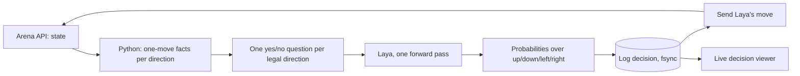

# CodeYatri: teaching Laya to play

Team **CodeYatri** for Genesis 2.0, PS 02 "Beat the Bot: Teach Laya to Play": Adarsh Singh (lead), Piyush Shukla, Mayuresh Sarkale, Vidushi Singh.

A decision layer that plays the hosted games on [topgameai.com/arena](https://topgameai.com/arena) through their agent API. **Every move comes from a visible, logged call to [Laya](https://github.com/NandhaKishorM/laya)**, a small open-weight decision model. Python reads the game, writes true facts about each possible move, asks Laya one yes/no question per direction, plays Laya's highest-rated move, and logs the decision before sending it.

## Verified results (real arena sessions)

| Game | Session id | Points | Notes |
|---|---|---|---|
| Snake | `2ba7267e-def5-4fdc-aa53-0a249329eab9` | **1000** (15 of 15 foods, 127 moves) | Base Laya `english`, zero-shot, no fallback moves, log verified |
| Snake | `c286e971-3fd1-4b3b-b310-e2b264db8338` | **1000** (15 of 15 foods, 147 moves) | Second run, same setup, all moves decided by Laya |
| Snake | `5e8400b5-b56b-4dc7-8d5d-b12e8a146567` | **1000** (15 of 15 foods, 130 moves) | Third run, same setup, all moves decided by Laya |
| 2048 | `df7287a4-1132-46f9-bc06-6b3db9a9a3fa` | **437** (best tile **512**, 586 moves) | Fine-tuned Laya (see below), all 586 moves decided by Laya, no fallback moves, log verified against the server. Passes the 512 gate |

Every real session, including failed or abandoned ones, is listed in [`docs/results.md`](docs/results.md). The logs are in [`runs/`](runs/).

Check any session against the arena server's own record: `python -m laya_agent.arena.verify <session_id>` (hash chain, steps, final board, score).

## How a move is made



1. **Facts, never verdicts.** For each direction Python states what the move does right now: wall or body hit, food eaten, distance to the food before and after, open space left; for 2048, whether the largest tile stays in its corner, board order, empty cells, merges. It never says which move is best, and never looks more than one move ahead.
2. **One Laya call per move.** One `noul` (yes/no) question per legal direction, answered in a single pass. The four P(true) values are normalised into the required probability block, and the highest is the move.
3. **Log before act.** The decision is written and fsynced before the move is sent. Each log line is hash-chained (`hash = sha256(prev_hash + "|" + canonical JSON)`), exactly as the participant guide specifies.
4. **Safe API handling.** A move is sent once. If a response is lost, the session is read back from the server instead of resending, so no move is ever applied twice.
5. **Fallback.** A rule-based safety move is allowed by the rules for at most 10% of moves. Our verified Snake run used none.

## What we ask Laya, and why

The problem statement says teams using the same model will score very differently. These measured findings are why ours works ([`docs/experiments.md`](docs/experiments.md) has the full log):

| Finding | Before | After |
|---|---|---|
| One yes/no per move instead of one multiple-choice question (grid test) | 0.61 to 0.69 | 1.00 |
| Remove the direction word from the question; Laya's prior for "right" was outweighing the facts (Snake) | 0.61 | 0.99 |
| Priorities line in every question (without it Laya picked fatal moves) | 43 fatal picks in 200 | 0 |
| Eat fact worded like the options Laya already reads well | circled the food for 300 moves | wins |
| "Moves since the last food" fact, so a deterministic model cannot repeat the same loop | 1 game stuck | 20 of 20 won in simulation |

## 2048: fine-tuned Laya

Zero-shot Laya never reached a 512 tile in 14 simulated games, even with good facts. A program that follows the stated priorities exactly from the same facts reaches 512 in 75% of games, which showed the facts carry the signal and Laya's reading was the bottleneck. The organisers confirmed fine-tuning Laya is allowed, so:

- **Dataset (built by us, kept private on Kaggle):** 2048 boards from our local simulator, the exact questions our bot asks, and true/false labels from the stated priorities applied to one-move facts. No search, no other model. Built by [`scripts/make_2048_dataset.py`](scripts/make_2048_dataset.py); round 2 adds the boards our fine-tuned Laya itself reaches.
- **Training:** Laya's official `laya-train` / `laya.train.finetune`, on a laptop RTX 3050 (decision head) and on Kaggle T4 GPUs (full model, [`notebooks/kaggle_finetune_2048.py`](notebooks/kaggle_finetune_2048.py)).
- **Result so far (simulator):** zero-shot Laya reached 512 in 0 games; the decision-head fine-tune in 7 of 24; the full-model fine-tune in **19 of 24 (79%)**, with 14 games reaching 1024 and one reaching 2048 (median 586 points on fresh seeds). Held-out yes/no agreement went from 0.49 to 0.93.

The move is still always Laya's own answer; only the checkpoint changes.

## Run it

Python 3.10 or newer.

```bash
python -m venv .venv
.venv\Scripts\activate                 # macOS/Linux: source .venv/bin/activate
pip install -e ".[dev]"
# GPU: install the CUDA build of torch from pytorch.org into the same environment

# live decision viewer (keep it visible while the bot plays)
python -m laya_agent.viewer.arena_web runs --port 8770 --sim-roots "runs_sim*"   # http://127.0.0.1:8770
# header: Snake | 2048 switcher, Arena (real) vs Simulator (test); Board view shows the public leaderboard

# one real session on the arena, agent name CodeYatri
python -m laya_agent.arena.runner --game snake
python -m laya_agent.arena.runner --game 2048 --style v3 --model <fine-tuned checkpoint dir>

# local simulators (test only, never reported as results)
python -m laya_agent.arena.runner --game snake --sim --seed 1
python scripts/eval_arena.py --game snake --games 10

pytest -q
```

Each session writes three files to `runs/<game>/`: `<session_id>.jsonl` (the submission log, hash-chained), `<session_id>.events.jsonl` (facts and raw P(true) for the viewer) and `<session_id>.final.json` (the game's final response, saved the moment it ends). The runner prints a verifier report at the end: hash chain, contiguous steps, decision blocks, fallback share, and a match against the final response.

## Stage 3: the real Doom

The organisers confirmed stage 3 is the actual Doom, played in an open-source engine on our own machine with Laya making every decision. We use [ViZDoom](https://github.com/Farama-Foundation/ViZDoom) (GPL, built on ZDoom) with the free [Freedoom](https://freedoom.github.io/) game data (BSD), so no paid game files are needed. Code: [`src/laya_agent/doom/`](src/laya_agent/doom/).

- **What Laya reads.** The engine's own state, turned into text: health, ammo, enemies in view with their angle and distance, and one sentence per action saying what that action does right now (the shot hits the Imp or hits nothing, a 5 degree turn puts the Imp in the crosshair, forward is open for 400 units into unexplored ground, a step left leaves a fireball's path, use opens the door ahead). No vision model: the screen is for people only.
- **How an action is chosen.** One Laya call per decision with one yes/no question per offered action (shoot, turn 5 or 30 degrees left or right, forward, back, strafe left or right, use). The highest P(yes) is played and held for 4 game tics. No rule-based override: every logged decision has source `laya`.
- **No search.** Facts are one-step readings (a straight line to the first wall, where an enemy ends up after one turn). Memory is only what the player has done and seen: visited ground, the last action, a door already pressed.
- **Real time.** The engine can run at Doom's 35 tics a second while Laya decides (about 100 to 170 ms per decision on the RTX 3050), or wait for each decision.
- **Proof.** Each episode writes the same hash-chained log as the arena games (Doom's action names as the probability keys), the full decision record, and the engine's demo recording, whose sha256 is in the final record. Replaying the recording in the engine reproduces the result; the Doom page of the dashboard runs that check.
- **Result (11 fixed games, E14 and E15).** Untrained Laya: 51 kills, no corridor cleared. Fine-tuned Laya: 196 kills and the deadly corridor cleared 3 of 3, more than the rule reader that labelled its training data (163), with every action Laya's own (0 fallback).
- **Training.** Laya is fine-tuned on Doom facts with labels from a fixed priority reading of the same facts, collected from offline games on the nine Freedoom E1 maps, eight Doom II style maps and the ViZDoom combat scenarios.

```bash
pip install -e ".[doom]"
# one episode of the first Freedoom level, game window visible, real time, screen captures for the dashboard
python -m laya_agent.doom.runner --scenario freedoom1:E1M1 --model data/ftdoom/ckpt_quick_frozen --realtime --visible --frames
# dashboard: http://127.0.0.1:8770/doom (or the Doom button in the header)
```

## Repository layout

```
src/laya_agent/
  arena/      client.py (arena API), games.py (Snake and 2048 facts), grid_facts.py, grid_game.py,
              decider.py (the only move chooser), spec_log.py (submission log + verifier),
              runner.py (one session), sims.py (local test simulators)
  viewer/     arena_web.py + arena_static/ (live decision viewer)
  decision/, game/, telemetry/, loop.py   earlier generic engine (pre-hackathon prototype)
scripts/      eval_arena.py, probe_snake.py, probe_2048.py, make_2048_dataset.py
notebooks/    Kaggle fine-tuning script, Colab runner
tests/        unit and integration tests (a fake Laya lives only here)
docs/         experiments.md, writeup.md, results.md, decisions.md, research.md, hackathon-day.md, evidence/
runs/         real arena session logs
```

## Write-up

[`docs/writeup.md`](docs/writeup.md): what we asked Laya, why, what failed, and what we changed.

## Attribution

Laya source, docs and Python package: [NandhaKishorM/laya](https://github.com/NandhaKishorM/laya) (Apache-2.0). Model checkpoints: [convaiinnovations/laya](https://huggingface.co/convaiinnovations/laya) on Hugging Face. Games: [TopGameAI Arena](https://topgameai.com/arena).
