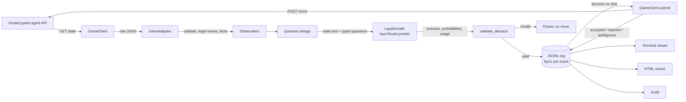

# Architecture

## Data flow

## Modules

| Module | Responsibility | Game specific? |
|---|---|---|
| `config.py` | Settings from env and `.env`; secrets never logged | No |
| `contracts.py` | `Observation`, `Candidate`, `Decision`, `SubmitResult`, error types | No |
| `game/transport.py` | HTTP with timeouts; GET retried with backoff; POST never retried | No |
| `game/base.py` | `GameClient` and `GameAdapter` interfaces | No |
| `game/hosted_template.py` | Skeleton for each hosted game; every unknown marked UNRESOLVED | Yes, filled on the day |
| `game/local_fixture.py` | Coin-grid test fixture, labelled `LOCAL_FIXTURE` | Test only |
| `decision/questions.py` | Question designs and aggregation rules, each with an id | No |
| `decision/laya_client.py` | The only move chooser: one `Router.predict` call per decision | No |
| `decision/validation.py` | Maps Laya's answer to exactly one legal candidate, or rejects it | No |
| `loop.py` | Read, validate, decide, log, submit, reconcile, repeat | No |
| `telemetry/` | Event schema, redaction, bounded fields, fsynced JSONL | No |
| `viewer/` | Terminal and HTML viewers that read the same events | No |
| `audit.py` | Proves from the log that each move traces to a valid Laya decision | No |

## Loop and recovery rules

1. Fetch state. GET errors are retried a bounded number of times.
2. Validate it in the adapter. A malformed state is logged as `state_invalid` and refetched up to `BOT_MAX_STATE_REFETCH` times; after that the bot pauses. Missing fields are never filled in.
3. A terminal state logs `game_over` with the score and session info, then `run_end`.
4. No legal moves: pause and log the raw state.
5. One Laya call. A crash is `decision_rejected`; a malformed or illegal answer is logged as a `decision` with `valid: false`. Up to `BOT_MAX_DECISION_RETRIES` fresh calls, then pause. There is no fallback move.
6. The `decision` event is fsynced **before** the move is sent. The loop asserts this.
7. Submit once. `accepted` continues; `rejected` pauses; `ambiguous` (timeout after send) triggers `reconcile` against fresh state: `applied` continues, `not_applied` gets a new Laya decision, `unknown` pauses rather than risk a duplicate move.

## Decision log schema (version 1)

Every event: `schema`, `seq`, `ts` (UTC ISO 8601), `run_id`, `env` (`HOSTED` or `LOCAL_FIXTURE`), `type`.

| Event | Main fields |
|---|---|
| `run_start` | game_id, design_id, model, git_commit, python, settings (token shown only as set/unset) |
| `model_loaded` | laya_version, model, revision (commit SHA), device, cold_load_s, head_max_len, max_len |
| `state_invalid` | attempt, error, raw_state |
| `decision` | decision_id, turn_id, state_hash, state_text, raw_state, candidates (id, description, facts), design_id, aggregation, aggregate_detail, question (exact dict sent), label_to_action, laya_response (raw), routing, usage (incl. head_budget), chosen_label, chosen_action_id, probabilities, answer_confidence, confidence, latency_ms, valid, validation_problems |
| `decision_rejected` | attempt, error or problems |
| `submission` | decision_id, turn_id, action_id, payload, status, detail, response, submit_ms |
| `reconcile` | decision_id, verdict |
| `game_over` | turn_id, score, session |
| `pause` | reason, context |
| `run_end` | status, final_score, decision and move counts, latency p50/p95/max, session |

Values larger than `BOT_LOG_MAX_FIELD_CHARS` are stored as a preview plus sha256. Keys such as `token`, `password`, `authorization`, `api_key` are redacted at any depth, and the configured token string is scrubbed from every value.

## Test matrix

| Area | Covered by |
|---|---|
| Malformed and missing state, refetch, pause | `test_loop.py` |
| Empty legal-action list, terminal state | `test_loop.py` |
| Duplicate and unknown action ids | `test_decision.py` |
| Laya crash, malformed response, off-list answer, illegal answer, bad probabilities, collapsed options | `test_decision.py`, `test_loop.py` |
| No fallback move when Laya fails | `test_loop.py` |
| GET retry, POST never retried, timeout is ambiguous | `test_transport.py` |
| Ambiguous submit: applied, not applied, unknown | `test_loop.py` |
| Stale turn rejection | `test_loop.py` |
| Torn last line after a crash, fsync per event, redaction | `test_telemetry.py` |
| Every submission traces to a valid decision | `test_loop.py`, `test_telemetry.py` (audit) |
| Viewer output equals the log | `test_viewer.py` |
| Real Laya inference and output shape | `scripts/smoke_laya.py` |
| Question-design quality | `scripts/eval_designs.py` |

## Unresolved until hackathon day

Base URL, endpoints, authentication, state schema, action schema, turn or sequence ids, idempotency support, score and verification fields, session ids, terminal semantics, rate and time limits, and stage-unlock mechanics. None of these are guessed in code.
